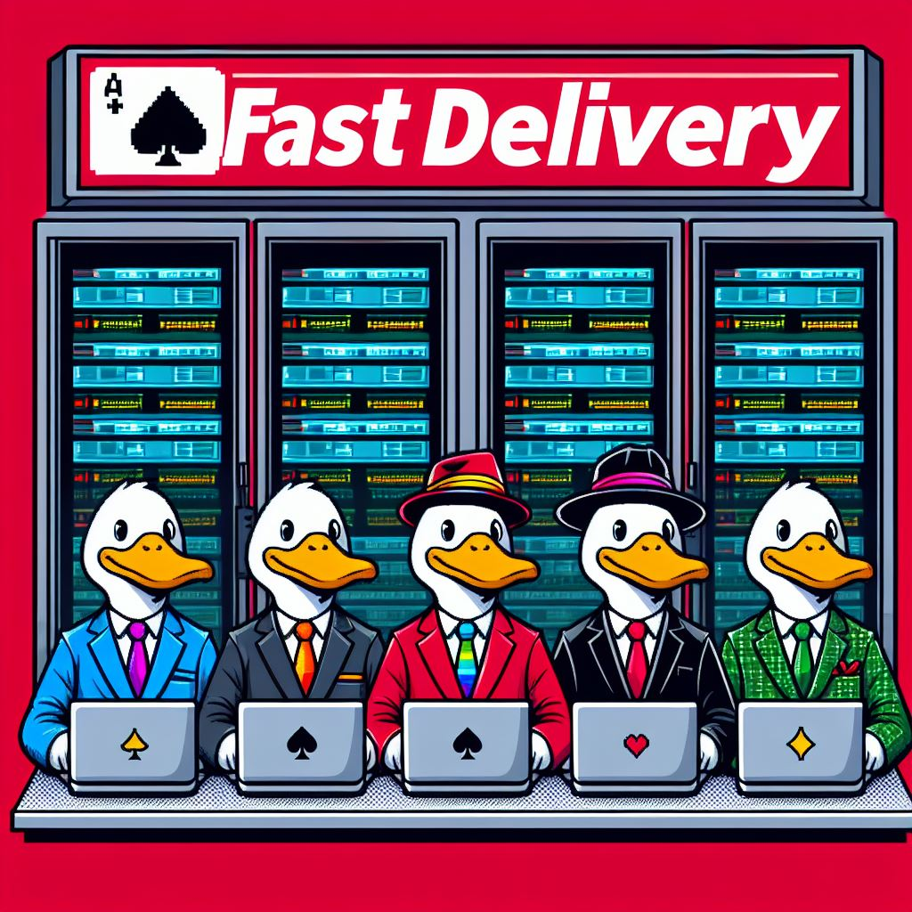

# docs-as-code-showcase

Technical documentation treated like software: AsciiDoc source under version control, built by CI into a PDF and a website, reviewed through pull requests.

<p align="center"></p>

## What this is

**Problem.** Operations knowledge usually lives in wiki pages and Word files: unversioned, unreviewed, and out of date the week after they are written.

**Approach.** Write the documentation in plain text (AsciiDoc), keep it in Git, and let a pipeline produce every output format. A change to a procedure is a commit; a review is a pull request; a release is a tag.

**Example.** The showcase document is a real network operations runbook that I wrote and maintained as a consultant on a multi-vendor telecom infrastructure (Cisco ASA Firepower, ASR, Nexus, ISE; F5 BIG-IP; Imperva WAF; Solaris and Linux hosts; Zabbix; Oracle). It covers day-to-day changes, certificate lifecycle, patching, monitoring and the final decommissioning.

## Fictionalised, deliberately

The project has been decommissioned, and every identifier in the runbook has been replaced. Organisations, people, domains, hostnames and addresses are fictional and borrow from the *Alien* universe:

| Role in the runbook | Name used |
|---|---|
| Customer (telecom operator) | Seegson Communications, `seegson.example` |
| Consultancy running operations | Weyland-Yutani |
| Application vendor | Kelland |
| Third parties behind the DMZ | Hyperdyne, Lasalle |
| Migration project | Sevastopol |

Other people appear as roles (`noc.lead`, `change.manager`); only the author is real. IP addresses use RFC 1918 and RFC 5737 ranges and stay internally consistent, so routes, ACLs and masks in the examples still make sense. Screenshots are redacted with an OCR-driven pipeline and checked by hand. The vendors and products are real, because they are the point.

## Repository layout

```
docs/modules/ROOT/
  pages/fastdelivery-runbook.adoc   the runbook (AsciiDoc, ~3,600 lines)
  images/                           redacted screenshots
diagrams/fastdelivery-topology.mmd  network topology (Mermaid)
scripts/build-pdf.sh                one command, used locally and in CI
.github/workflows/build-pdf.yml     builds the PDF on every change
```

The `docs/modules/ROOT` layout is the Antora component structure; the published site is the next step.

## Build

Locally:

```sh
gem install asciidoctor-pdf rouge
scripts/build-pdf.sh            # writes build/fastdelivery-runbook.pdf
```

In CI the same script runs on every push and pull request that touches `docs/`. The PDF is attached to the workflow run as an artifact and, on a version tag, to the GitHub release. The PDF itself is never committed: the source is the single source of truth.

## Roadmap

- [x] Runbook source, fictionalised and reviewed
- [x] PDF build in CI
- [ ] Antora site published to GitHub Pages
- [ ] Topology diagram rendered in the build
- [ ] Style checks (Vale) on pull requests

## Author

Gabriele Saronni, IT infrastructure and automation.
